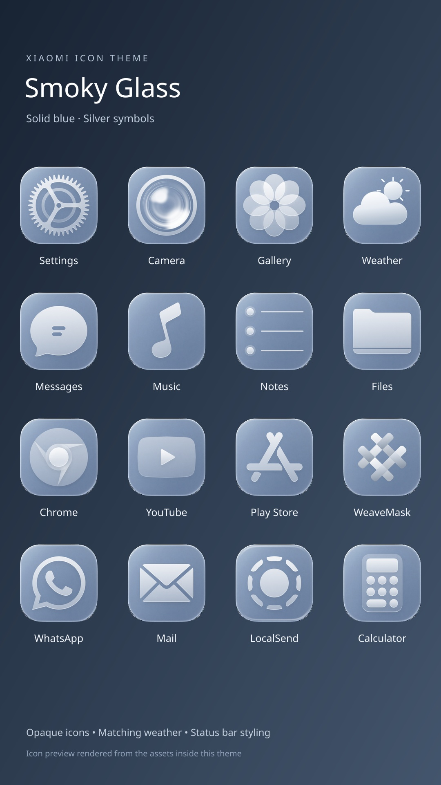

# Xiaomi Smoky Glass

## Solid Blue v2

[Download the latest MTZ](https://github.com/OlahDavidXdd/glass-ximi/releases/download/solid-blue-v2/Smoky_Glass_Solid_Blue_v2.mtz)

- 674 opaque blue-gray app icons with silver symbols.
- Matching weather icon, WeaveMask support, and App Store-style Play Store symbol.
- Embedded icon previews rendered from the included assets.
- Control center overlays removed; status bar styling retained.

## Previous backup

[Download the previous backup](https://github.com/OlahDavidXdd/glass-ximi/releases/download/smoky-glass-backup-v1/Smoky_Glass_Backup.mtz)

Based on Guofeng 26 Lite Edition by 一凡UI. Original creator metadata is preserved in the theme. Archive contents validated; installation has not been tested on a Xiaomi device.
