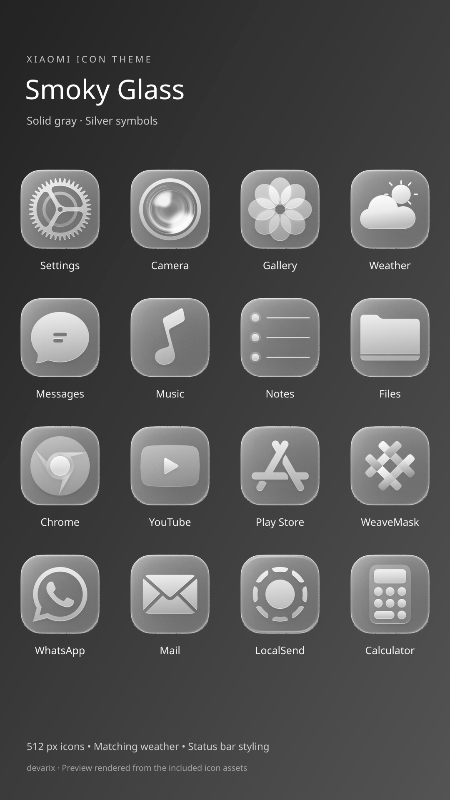
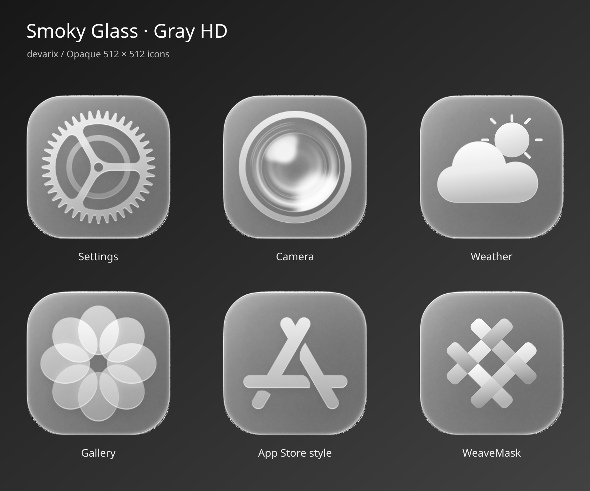

# Smoky Glass Gray HD v4

Developer: **devarix**

[Download Gray HD v4](https://github.com/OlahDavidXdd/glass-ximi/releases/download/gray-hd-v4/Smoky_Glass_Gray_HD_v4.mtz)

700 opaque grayscale app icons at 512 × 512. No blue tint. Includes the previously missing apps from the device photos, matching weather, WeaveMask, and the App Store-style Play Store symbol. All original theme gallery images have been removed; only the three new icon previews remain inside the MTZ. Status bar styling retained; control center overlays removed.

[Previous Gray HD v3](https://github.com/OlahDavidXdd/glass-ximi/releases/tag/gray-hd-v3) · [Original backup](https://github.com/OlahDavidXdd/glass-ximi/releases/tag/smoky-glass-backup-v1)

Archive integrity, grayscale channels and opacity validated; not tested on-device. Adapted from Guofeng 26 Lite Edition by 一凡UI. [Additional icon sources](gray-hd-v4/sources.md).

The gray-hd-v4 parts are build inputs for GitHub Actions. Download the complete MTZ from Releases.
