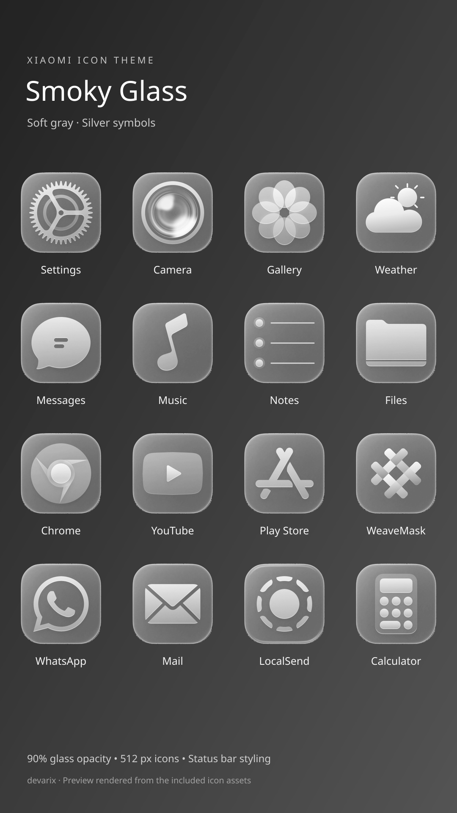
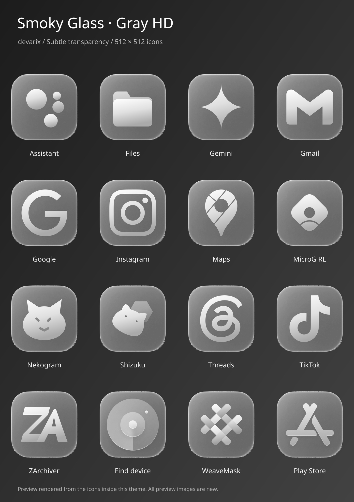

# Smoky Glass Soft Gray v5

Developer: **devarix**

[Download Soft Gray v5](https://github.com/OlahDavidXdd/glass-ximi/releases/download/gray-hd-v5/Smoky_Glass_Soft_Gray_HD_v5.mtz)

Same 700 neutral-gray 512 × 512 app icons, with subtle transparency at approximately 90% background opacity. Silver symbols, matching weather, WeaveMask and App Store-style Play Store symbol preserved. Only the three updated icon previews are embedded. Status bar styling retained; control center overlays removed.

[Opaque v4 backup](https://github.com/OlahDavidXdd/glass-ximi/releases/tag/gray-hd-v4) · [Original backup](https://github.com/OlahDavidXdd/glass-ximi/releases/tag/smoky-glass-backup-v1)

Validated archive, neutral grayscale and alpha levels. Not tested on-device. Based on Guofeng 26 Lite Edition by 一凡UI; [additional icon sources](gray-hd-v4/sources.md).

The gray-hd-v5 parts are build inputs. Download the complete MTZ from Releases.
