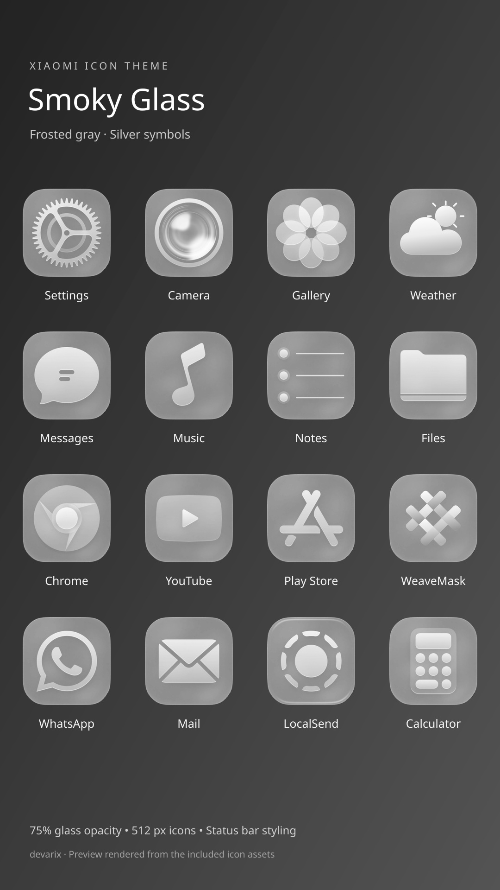
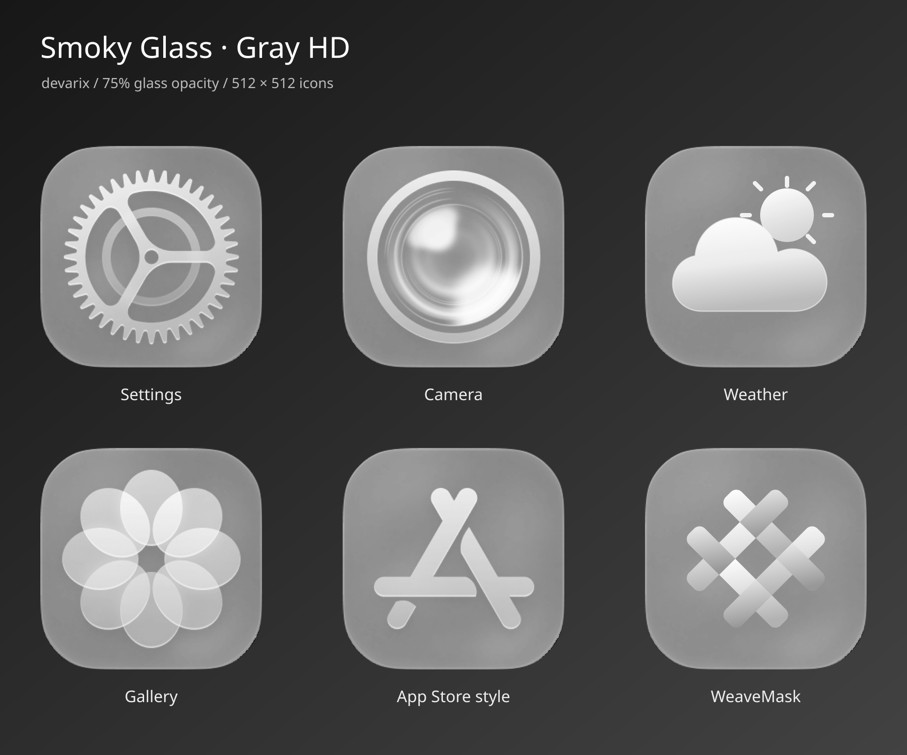
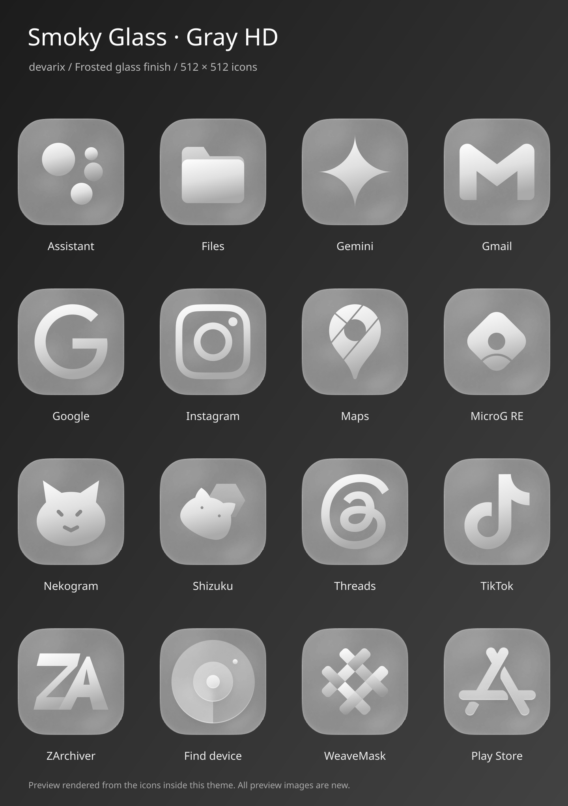
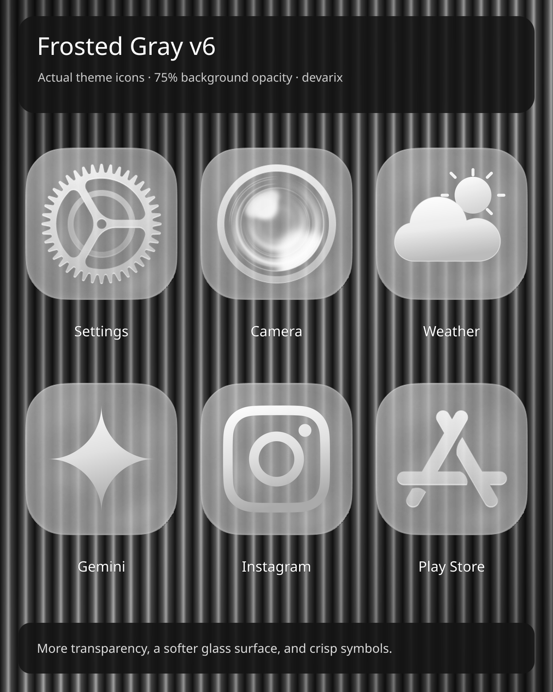

**Latest launcher test:** [0.7.0 APK and source](https://github.com/OlahDavidXdd/glass-ximi/releases/tag/kashi-glass-addon-v0.7.0-test) · Clearer glass, white center symbols, loaded-hook version checks and connected-hook restart. [Setup and buildable source](launcher-addon). **After installing from an older running hook, reboot once** if root restart is blocked. Previous builds remain under [Releases](https://github.com/OlahDavidXdd/glass-ximi/releases).

# Smoky Glass Frosted Gray v6

Developer: **devarix**

[Download Frosted Gray v6](https://github.com/OlahDavidXdd/glass-ximi/releases/download/gray-hd-v6/Smoky_Glass_Frosted_Gray_HD_v6.mtz)

700 gray 512 × 512 icons with 75% background opacity, a softer frosted surface, and sharp silver symbols. The frosted finish is static; MTZ icons cannot blur the wallpaper beneath them in real time. All app coverage and status bar styling retained; control center overlays removed. Only new icon previews are embedded.

[90% opacity v5](https://github.com/OlahDavidXdd/glass-ximi/releases/tag/gray-hd-v5) · [Opaque v4](https://github.com/OlahDavidXdd/glass-ximi/releases/tag/gray-hd-v4)

Archive, grayscale channels and opacity validated; not tested on-device. Based on Guofeng 26 Lite Edition by 一凡UI; [additional sources](gray-hd-v4/sources.md). Download the complete MTZ from Releases; the parts are build inputs.
